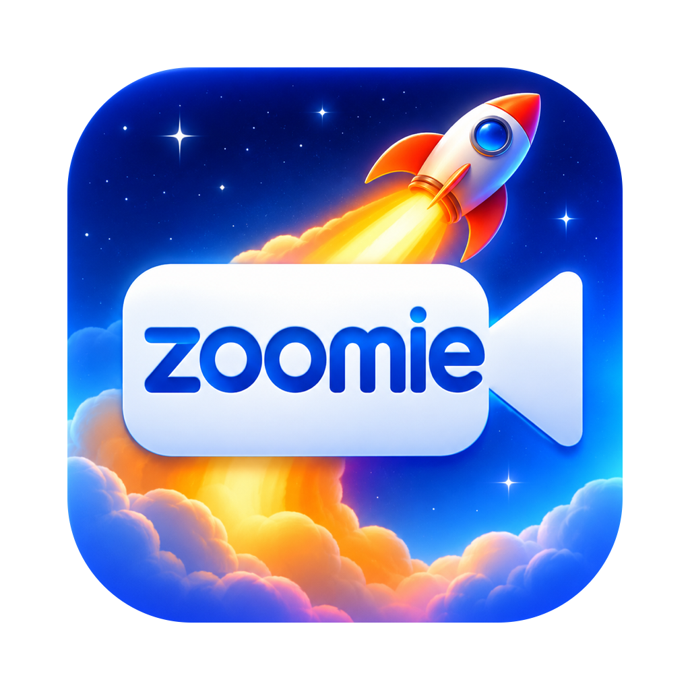

<p align="center"></p>

# Zoomie Toolz

A free Mac app that sits between your webcam and Zoom. Loop a clip of yourself, show a picture or a black screen, blur your background, turn your Zoom video on and off from anywhere, and leave meetings on time. Everything runs on your Mac: no accounts, no uploads, no telemetry.

Video reaches Zoom through **OBS Virtual Camera** (part of the free OBS Studio), so no Apple Developer account is needed.

## Download

**[Zoomie-Toolz-1.0.dmg](https://github.com/TechnAudioToolz/zoomie-toolz/releases/latest)** (under Assets on the latest release, about 2.5 MB)

- Needs **macOS 14 Sonoma or newer**, on Apple Silicon or Intel.
- Open the `.dmg` and drag **Zoomie Toolz** to Applications.
- **First launch:** the app isn't registered with Apple, so macOS blocks it once. Go to **System Settings → Privacy & Security** and click **Open Anyway**. You only do this once.

## One-time setup

1. Install **[OBS Studio](https://obsproject.com/download)** (free), or `brew install --cask obs`.
2. Open OBS once and click **Start Virtual Camera** (bottom right).
3. macOS says system software was blocked. Allow it:
   - **macOS 14 Sonoma:** System Settings → **Privacy & Security** → click **Allow** next to the OBS message.
   - **macOS 15 or newer:** System Settings → General → **Login Items & Extensions** → Camera Extensions → turn on OBS.
4. Quit OBS. It doesn't need to be open after this.
5. Open Zoomie Toolz and allow camera access. The **Virtual camera** dot turns green when it's sending video.
6. In Zoom: **Settings → Video → Camera → OBS Virtual Camera**.

Zoomie Toolz checks all of this every time it opens and shows a popup explaining anything that's missing. Run the checks again any time from **Zoomie Toolz → Check Setup…** or the menu bar.

## What it does

- **Live previews:** *Input* (your camera, untouched) and *Output* (exactly what Zoom sees) side by side. The window resizes and the previews grow with it. The ↗ button on each opens it in its own window (`⌥⌘1` / `⌥⌘2`).
- **Live:** passes your camera straight through.
- **Loop:** **Record Loop** (`⌃⌥R`), sit naturally for 10–30 seconds, stop, then switch to **Loop** (`⌃⌥L`). Zoom sees the clip on repeat. **Load Video…** loops any movie file instead.
- **Image:** show a still instead of live video (`⌃⌥I`). **Choose Image…** picks any picture, **Freeze Frame** grabs what your camera shows right now, and **Black** shows a plain black screen. Click the picture thumbnail to choose another.
- **Blur background** (`⌃⌥B`): keeps you sharp and blurs everything behind you, with a strength slider. Uses Apple's on-device person detection. Loops recorded and frames frozen with blur on are blurred too.
- **Start/Stop Zoom Video** (`⌃⌥V`): presses Zoom's own Start/Stop Video for you and shows whether your video is on. Needs Accessibility permission once (System Settings → Privacy & Security → Accessibility).
- **Leave Zoom automatically:** quits Zoom at a set time, or in 15/30/60 minutes, which drops you from the meeting. The time is filled in with the next top of the hour when the app opens (open at 6:01 pm → 7:00 pm). **Leave Now** does it straight away.
- **Smooth switching:** a short crossfade every time you change modes.
- **Hotkeys work anywhere**, even while Zoom is in front. All controls are also in the **menu bar**, so you can close the window and keep it running.

Tip: for a loop nobody notices, start and end the clip in roughly the same pose.

Zoomie Toolz has to stay running for Zoom to see your video. If it's closed, OBS Virtual Camera shows OBS's placeholder.

## Building from source

Needs Xcode 16 and [XcodeGen](https://github.com/yonaskolb/XcodeGen) (`brew install xcodegen`).

```bash
git clone https://github.com/TechnAudioToolz/zoomie-toolz.git && cd zoomie-toolz
xcodegen generate                 # only needed after editing project.yml
scripts/make_offline_dmg.sh       # the release DMG: build/Zoomie-Toolz-<version>.dmg
```

For a quick debug build that runs in place:

```bash
xcodebuild -project ZoomieToolz.xcodeproj -scheme ZoomieToolz -derivedDataPath build/preview CODE_SIGN_IDENTITY=- CODE_SIGN_STYLE=Manual DEVELOPMENT_TEAM= CODE_SIGN_ENTITLEMENTS= ENABLE_HARDENED_RUNTIME=NO build && open "build/preview/Build/Products/Debug/Zoomie Toolz.app"
```

## Optional: your own "Zoomie Cam" (paid Apple Developer account)

The project also contains its own camera extension, **Zoomie Cam**, which shows up in Zoom under its own name (and can be renamed from the app). macOS only installs camera extensions signed by a paid Apple Developer account, so the release DMG leaves it out and uses OBS Virtual Camera instead.

1. Set `DEVELOPMENT_TEAM` in `Config/Signing.xcconfig` (and optionally `APP_BUNDLE_ID`).
2. Open `ZoomieToolz.xcodeproj`, check Signing & Capabilities for both targets (System Extension on the app, App Groups on the extension), and build.
3. Copy **Zoomie Toolz.app** to /Applications and open it from there.
4. Under **Virtual camera**, choose **Send video to: Zoomie Cam**, click **Install**, and approve it in System Settings.
5. Restart Zoom and choose **Zoomie Cam**.

## How it works

```
Webcam ─▶ Zoomie Toolz ─(CoreMediaIO sink stream)─▶ OBS Virtual Camera  ─▶ Zoom
            │ 30 fps, 1920x1080                     (or Zoomie Cam)
            │ live / loop / image, blur, crossfade
            └▶ loop recording (H.264, ~/Library/Application Support/Zoomie Toolz/)
```

OBS's camera extension and Zoomie Cam both have a "sink" stream that accepts frames from another app and passes them to whatever app is reading the camera. Zoomie Toolz renders every frame and pushes it into that sink.

| File | What it does |
|---|---|
| `App/Engine.swift` | 30 fps render loop: live / loop / image, blur, crossfade, recording |
| `App/SinkFeeder.swift` | Finds the virtual camera through CoreMediaIO and sends frames into its sink |
| `App/CameraSource.swift` | The real webcam (AVCaptureSession) |
| `App/LoopPlayer.swift`, `App/LoopRecorder.swift` | Looping playback and recording |
| `App/LiveVideo.swift` | Live preview views and windows |
| `App/ZoomVideoControl.swift` | Reads and presses Zoom's Start/Stop Video menu item (Accessibility) |
| `App/ZoomLeaver.swift` | Scheduled Zoom quit |
| `App/LaunchChecks.swift` | Setup checks and popups at launch |
| `App/HotKeys.swift` | Global hotkeys (no Accessibility needed) |
| `App/ExtensionInstaller.swift`, `Extension/` | The optional Zoomie Cam camera extension |
| `scripts/make_offline_dmg.sh` | Builds the release DMG |
| `Resources/donate.html` | The Donate page |

## Troubleshooting

- **Zoom shows the OBS logo instead of you:** make sure Zoomie Toolz is open and the Virtual camera dot is green. Quit and reopen Zoom if it was open before OBS's camera was approved.
- **"OBS Virtual Camera" missing in Zoom:** the OBS approval didn't finish. Run **Check Setup…** and follow the popup.
- **Start/Stop Zoom Video stays grey:** allow Zoomie Toolz under Privacy & Security → Accessibility. If you rebuild the app yourself, macOS may ask again; remove the old entry and add it back.
- **"Join a Zoom meeting" while you're in one:** the button looks for Zoom's "Start Video" / "Stop Video" menu items, so a Zoom set to another language won't match yet.
- **No camera in the Input preview:** allow Zoomie Toolz under Privacy & Security → Camera.

## Support

Zoomie Toolz is free. If it's useful, the **Donate** button (heart in the toolbar) opens the support page. More free, offline Mac tools from [TechnAudioToolz](https://github.com/TechnAudioToolz).

Not affiliated with Zoom Video Communications or the OBS Project.

## License

MIT. See [LICENSE](LICENSE).
